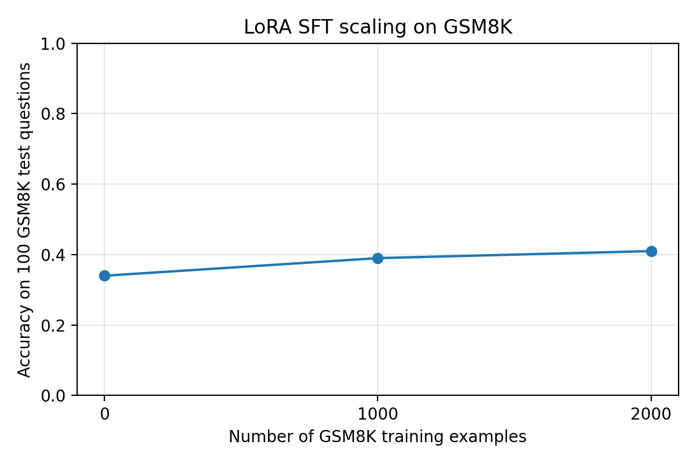
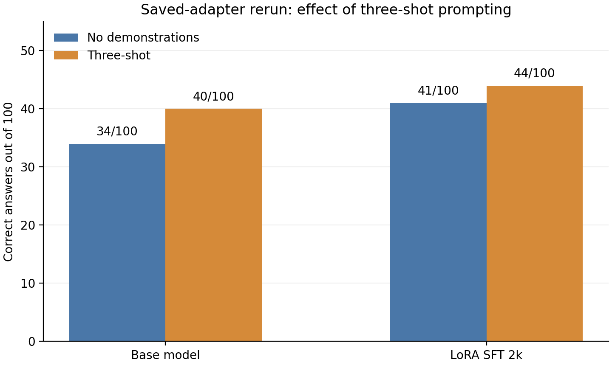

# Mathematical Problem Solving with Qwen and GSM8K

## Saved-adapter evaluation | ECE M146 course project

This report describes the executed old-adapter version of the mathematical reasoning project. The October 30, 2026 notebook run reused the included LoRA adapters and evaluated them on fixed GSM8K questions. The original combined course report and the fresh-training experiment are preserved outside this Git repository in the sibling archive.

## Question and method

We examined whether supervised fine-tuning with low-rank adapters and three worked examples improve a 1.5-billion-parameter instruction model on grade-school math word problems. The base model is `Qwen/Qwen2.5-1.5B-Instruct`; the dataset is `openai/gsm8k` (`main`). The notebook evaluates the first 100 test questions for its main comparisons. The bonus system-prompt comparison uses the first 50 test questions. The three few-shot demonstrations are fixed training examples at indices 0, 1, and 2.

The system prompt requires a final answer in `\boxed{ANSWER}` form. Generation uses greedy decoding (`do_sample=False`). The evaluator extracts a boxed answer when present, otherwise falls back to the last number, then normalizes and compares it with the GSM8K final answer. The same evaluator and test subset are used across the main settings.

Two saved adapters were available: one labeled as trained on 1,000 GSM8K examples and one labeled as trained on 2,000. Their stored configuration uses LoRA rank 8, alpha 16, dropout 0.05, and attention projections `q_proj`, `k_proj`, `v_proj`, and `o_proj`. The archived parameter-count summary records 2,179,072 trainable adapter parameters, approximately 0.141% of the 1,543,714,304 base-model parameters. The archived training summaries record one epoch, learning rate 0.0002, per-device batch size 2, and gradient accumulation 32. The October 30 run loaded the existing adapters; it did not independently retrain or verify their original training history.

## Results on the fixed 100-question subset

| Model and prompt | Adapter training examples | Correct / 100 | Accuracy |
| --- | ---: | ---: | ---: |
| Base model, no demonstrations | 0 | 34 | 34% |
| LoRA, no demonstrations | 1,000 | 39 | 39% |
| LoRA, no demonstrations | 2,000 | 41 | 41% |
| Base model, three-shot | 0 | 40 | 40% |
| LoRA, three-shot | 2,000 | 44 | 44% |

The 1,000-example adapter exceeded the base model by five percentage points without demonstrations; the 2,000-example adapter exceeded it by seven. These numbers describe this fixed 100-question subset, not the complete GSM8K test set.

### Effect of three-shot prompting

Three-shot prompting improved the base model from 34 to 40 correct and the 2,000-example adapter from 41 to 44 correct. The paired changes show that the gain was not uniform across questions:

| Model | Fixed by three-shot | Broken by three-shot | Net change | Boxed answers: no demo to three-shot |
| --- | ---: | ---: | ---: | ---: |
| Base model | 22 | 16 | +6 | 63/100 to 81/100 |
| LoRA 2,000 | 17 | 14 | +3 | 85/100 to 96/100 |

The worked examples made the required answer format more common, but they also changed some previously correct answers to incorrect ones. The strongest observed setting was the 2,000-example adapter with three-shot prompting at 44/100.

### Bonus: system-prompt wording

The base model was also evaluated on the first 50 test questions with four system prompts. Only prompt wording changed in this comparison.

| Prompt | Correct / 50 | Accuracy |
| --- | ---: | ---: |
| Original | 14 | 28% |
| Short and direct | 13 | 26% |
| Step by step | 15 | 30% |
| Equations and check | 16 | 32% |

The equations-and-check prompt had the highest score on this 50-question subset. The small differences should be treated as descriptive results for these questions, not as a broad ranking of prompting strategies.

## Reproducibility and limits

All 90 code cells in `GSM8K_Math_Reasoning_Old_Adapters.ipynb` completed on the local NVIDIA GeForce RTX 5070 Ti Laptop GPU without error outputs. Both adapter-loading cells detected the saved files and skipped training. The five main prediction files from this run match the previously archived predictions response for response. The output CSV and JSON files, charts, and adapter weights are under `outputs_old_adapters/`; the notebook PDF preserves the executed code and outputs.

An earlier course report stated 51/100 for the 2,000-example adapter with three-shot prompting. The archived predictions and this reproducible saved-adapter rerun both show 44/100 for that setting, so this report uses the verified 44/100 result. A separately trained adapter produced different outcomes; that run is outside the scope of this saved-adapter project.

The evaluation uses only 100 main test questions and 50 bonus questions. Scores may vary on other subsets or with a different adapter, base-model revision, library environment, or decoding setup.
